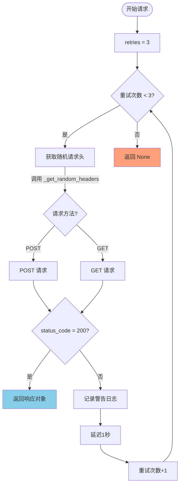
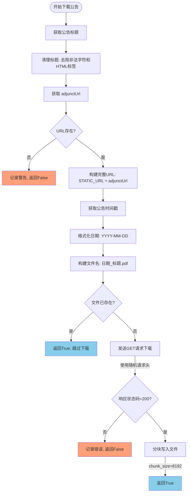

# AnnouncementService 处理流程

## 主流程图

```mermaid
flowchart TD
    Start([开始]) --> Init[初始化 AnnouncementService]
    Init --> |设置下载目录| CheckDir{下载目录是否存在?}
    CheckDir -->|否| CreateDir[创建下载目录]
    CheckDir -->|是| SetupSession[创建 Session 和 Logger]
    CreateDir --> SetupSession
    
    SetupSession --> Main[调用 fetch_and_download]
    Main --> |输入: stock_code, start_date, end_date| GetOrgId[获取 orgId]
    
    GetOrgId --> |调用 _get_org_id| SearchAPI[POST 请求 SEARCH_URL]
    SearchAPI --> |使用 _make_request| MakeReq1{请求成功?}
    MakeReq1 -->|失败| Retry1[重试最多3次]
    Retry1 --> MakeReq1
    MakeReq1 -->|成功| ParseOrgId[解析响应获取 orgId]
    ParseOrgId --> CheckOrgId{orgId 存在?}
    
    CheckOrgId -->|否| Error1[返回错误: 未找到orgId]
    CheckOrgId -->|是| GetColumn[推断板块 column]
    
    GetColumn --> |调用 _get_column_by_org_id| CheckPrefix{orgId 前缀?}
    CheckPrefix -->|gssz| SetSZSE[column = szse]
    CheckPrefix -->|gssh| SetSSE[column = sse]
    CheckPrefix -->|gsbj| SetBSE[column = bse]
    CheckPrefix -->|其他| SetDefault[column = szse 默认]
    
    SetSZSE --> InitPage
    SetSSE --> InitPage
    SetBSE --> InitPage
    SetDefault --> InitPage
    
    InitPage[初始化: page_num=1, total_downloaded=0] --> LoopStart{has_more?}
    
    LoopStart -->|是| GetAnnList[获取公告列表]
    GetAnnList --> |调用 _get_announcement_list| QueryAPI[POST 请求 QUERY_URL]
    QueryAPI --> |使用 _make_request| MakeReq2{请求成功?}
    MakeReq2 -->|失败| Retry2[重试最多3次]
    Retry2 --> MakeReq2
    MakeReq2 -->|成功| ParseAnnList[解析响应获取公告列表和总页数]
    ParseAnnList --> CheckAnnList{公告列表为空?}
    
    CheckAnnList -->|是| LoopEnd[退出循环]
    CheckAnnList -->|否| DownloadLoop[遍历当前页公告]
    
    DownloadLoop --> DownloadAnn[下载单个公告]
    DownloadAnn --> |调用 _download_announcement| GetTitle[获取并清理标题]
    GetTitle --> |去除非法字符| BuildFileName[构建文件名: 日期_标题.pdf]
    BuildFileName --> CheckExists{文件已存在?}
    
    CheckExists -->|是| Skip[跳过下载, 返回True]
    CheckExists -->|否| GetFileUrl[构建PDF文件URL]
    GetFileUrl --> |STATIC_URL + adjunctUrl| DownloadFile[GET 请求下载PDF]
    DownloadFile --> |使用 _get_random_headers| CheckStatus{状态码=200?}
    
    CheckStatus -->|否| DownloadFail[下载失败, 记录错误]
    CheckStatus -->|是| SaveFile[保存文件到磁盘]
    SaveFile --> DownloadSuccess[下载成功]
    
    DownloadSuccess --> Delay1[随机延迟 0.5-1.5秒]
    Skip --> Delay1
    DownloadFail --> Delay1
    
    Delay1 --> |调用 _smart_delay| CheckNext{还有公告?}
    CheckNext -->|是| DownloadAnn
    CheckNext -->|否| CheckPageNum{page_num >= total_pages?}
    
    CheckPageNum -->|是| LoopEnd
    CheckPageNum -->|否| NextPage[page_num++, 延迟 1-2秒]
    NextPage --> LoopStart
    
    LoopEnd --> ReturnSuccess[返回成功结果]
    Error1 --> ReturnError[返回错误结果]
    
    ReturnSuccess --> End([结束])
    ReturnError --> End
    
    style Start fill:#90EE90
    style End fill:#FFB6C1
    style Error1 fill:#FFA07A
    style ReturnError fill:#FFA07A
    style DownloadSuccess fill:#87CEEB
    style ReturnSuccess fill:#87CEEB
```

## 辅助方法详细流程

### _make_request 方法流程

### _download_announcement 方法流程

## 关键特性说明

1. **重试机制**: `_make_request` 方法会自动重试失败请求，最多3次
2. **反爬虫策略**: 
   - 使用随机 User-Agent
   - 随机延迟（0.5-2秒）避免请求过快
3. **文件去重**: 下载前检查文件是否已存在，避免重复下载
4. **错误处理**: 各个环节都有异常捕获和错误日志记录
5. **分页处理**: 自动处理多页公告列表，直到获取所有数据
