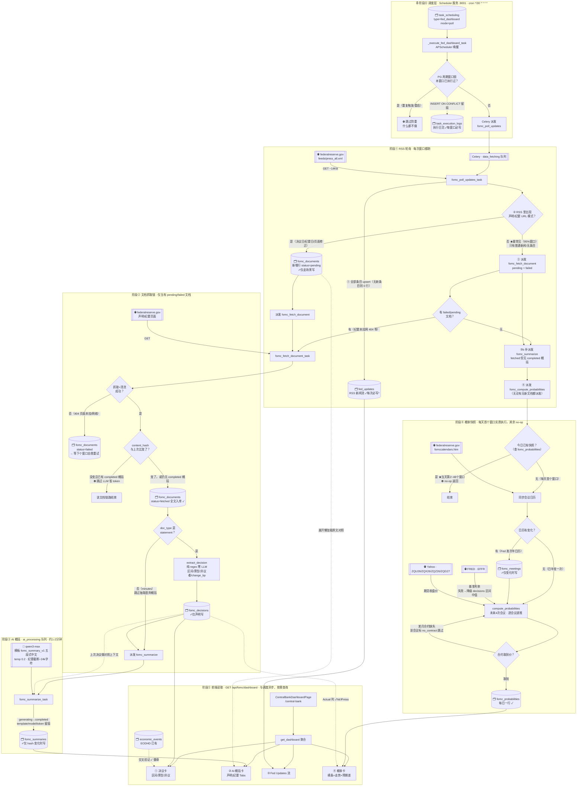

# FOMC 模块 · 每 30 分钟 Scheduler 触发的全流程（含分支场景）

> **创建**：2026-08-20
> **配套文档**：`CENTRAL_BANK_DASHBOARD_MODULE.md`（模块完整设计）、`SCHEDULER_DEVELOPMENT_GUIDE.md`（调度器）
> **用途**：理解 `task_scheduling` 行 `fed_dashboard`（cron `*/30 * * * *`）每次触发后，数据如何流经各服务并落库——**特别标注各分支情况（如 Fed 无新文档时在哪停、写哪张表）**

---

## 一、Mermaid 全流程图（决策分支版）



## 二、读图要点

| 节点形状 | 含义 |
|---|---|
| 圆柱 `🗂` | PostgreSQL 表（**实线箭头=写入，虚线=读取**；`✓` 标注该表在什么条件下被写） |
| 双线框 `🌐/🤖` | 外部服务（Fed 官网 / FRED / Yahoo / LLM） |
| 菱形 | 决策分支——**每条出线都标了条件**，`⛔` 表示提前结束/跳过 |
| `★` | 高频路径（绝大多数窗口走的分支） |

## 三、四大分支场景详解（对应图中菱形）

### 场景 A：Fed 无任何新文档（占 95% 的窗口）★日常态

```
窗口触发 → RSS 拉一遍
  ├─ fed_updates: 普通新闻条目有则 upsert，无则 0 行
  ├─ NEWDOC 判定"否" → 不产生 pending 文档 → 阶段②③完全不发生
  ├─ HASFAILED 判定"无" → 不重试
  └─ 概率: 当天首个窗口会实质执行；其余窗口 THRO 判"是" → no-op

实际开销: 1 个 HTTP 请求 + 少量 upsert，秒级结束
```

### 场景 B：决议日/纪要日（新文档出现）

```
RSS 发现声明或纪要 URL → fomc_documents(pending)
  → 派发抓取 → bs4 清洗 → hash 必然是新的（新文档）
  → statement 走 regex 抽取写 fomc_decisions；minutes 跳过
  → 派发 LLM → fomc_summaries（前端 generating 态 5s 轮询约 1-2 分钟）
```

### 场景 C：Fed 重新挂网但内容没变（hash 相同）

```
抓取成功 → content_hash 比对 → 没变
  → ⛔ 跳过 extract_decision 和 LLM 概括
  → 不写 fomc_decisions / fomc_summaries（token 零消耗）
  → fomc_documents 也只是状态刷新，全文不重复处理
```

### 场景 D：纪要尚未挂网（404，会后 3 周内的过渡期）

```
纪要 URL 按固定模式提前入库 pending → 抓取 404
  → fomc_documents 标 status=failed
  → 之后每个窗口派发 fomc_fetch_document（pending + failed 同一条链）
  → Fed 挂出页面那一刻走完抓取 + 概括，无需人工
  → 若曾漏派发概括：poll 还会对 fetched 且无 completed summary 的文档补派发
```

## 四、表与写入时机速查（按场景对号）

| 表 | 场景 A（无新文档） | 场景 B（新文档） | 场景 C（hash 未变） | 场景 D（404） |
|---|---|---|---|---|
| `task_execution_logs` | ✓ 每窗口 | ✓ | ✓ | ✓ |
| `fed_updates` | ✓（有新条目时） | ✓ | ✓ | ✓ |
| `fomc_documents` | — | ✓ pending→fetched | 状态刷新 | ✓ 标 failed |
| `fomc_decisions` | — | ✓ 仅 statement | — | — |
| `fomc_summaries` | — | ✓ | ⛔ 跳过 | — |
| `fomc_meetings` | 仅当天首窗口且日历有变 | 同左 | 同左 | 同左 |
| `fomc_probabilities` | 仅当天首窗口 | 同左 | 同左 | 同左 |
| `economic_events` | 只读（EODHD 管道维护） | 只读 | 只读 | 只读 |

## 五、三种典型场景的耗时对照

| 场景 | 实际执行 | 耗时量级 |
|---|---|---|
| **平常的 95% 时刻**（场景 A） | 仅阶段①：RSS→无新文档→概率已跑→结束 | 秒级 |
| **决议日 14:00 ET 后首个窗口**（场景 B） | ①→②→③→④全链自动 | ②秒级 ③约 1–2 分钟 |
| **纪要日**（场景 B 变体） | 同上但 doc_type=minutes，跳过抽取 | 同上 |

## 六、省钱 / 自愈 / 幂等三设计

1. **content_hash 去重**（场景 C）：Fed 偶尔修正页面重新挂网——hash 没变则跳过 LLM 概括，不烧 token
2. **双重自愈**（场景 D）：纪要 URL 按固定模式提前入库为 pending，Fed 未挂网时抓取 failed → 每 30 分钟对 pending+failed 派发 `fomc_fetch_document`（与新文档同一条抽取/概括链）→ 另对已 fetched 但无 completed 概括补派发 `fomc_summarize`。不要在 poll 内联 `retry_pending_documents`（会与 Celery 抢抓 pending，hash 写入后跳过概括）。
3. **全链幂等**：所有表写入均 `ON CONFLICT DO UPDATE` + UNIQUE 约束——任何一步重跑、任何任务重复派发，结果收敛到同一份数据，不会重复入库
