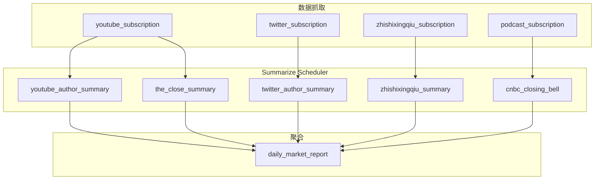

# 定期 Summarize Scheduler 开发标准

> 本文档定义 **YouTube Daily Report、Twitter Daily Report、知识星球摘要、Bloomberg The Close、CNBC Closing Bell** 等「定期 LLM 摘要」类 Scheduler 的统一开发契约与实现规范。  
> 新增同类 Scheduler 时，应优先遵循本标准，再参考各模块现有实现。

**相关文档**

| 文档 | 用途 |
|------|------|
| [SCHEDULER_DEVELOPMENT_GUIDE.md](./SCHEDULER_DEVELOPMENT_GUIDE.md) | Scheduler 全栈注册、DB 约束、前端、Celery 导入 |
| [SCHEDULER_COMMON_PITFALLS.md](./SCHEDULER_COMMON_PITFALLS.md) | 漏改一处就全挂的 Checklist 与真实故障案例 |
| [LLM_ARCHITECTURE_OVERVIEW.md](./LLM_ARCHITECTURE_OVERVIEW.md) | 模板、ConfigResolver、provider 兜底链 |
| [DAILY_REPORT_ARCHITECTURE.md](./DAILY_REPORT_ARCHITECTURE.md) | Daily Market Report 与上游摘要的聚合关系 |

**共享代码**

| 文件 | 用途 |
|------|------|
| `backend/services/summary_common.py` | 超时、并发、孤儿清理等跨摘要服务常量 |
| `backend/utils/datetime_utils.py` | `report_date`、内容窗口、时区换算 |

---

## 1. 架构分类

所有定期 Summarize 任务归入以下两类之一。**新增任务前先选定类型**，不要混用语义。

### 1.1 两阶段（Phase A → Phase B）

适用于：**按频道/作者/星球等「源」聚合内容，再按用户组装报告**。

```
Scheduler
  └─ Celery: generate_all_*_summaries        # Phase A 批量（全局 LLM）
        └─ chain ─► generate_all_*_reports   # Phase B fan-out（机械拼接，通常不调 LLM）
              └─ generate_*_report (per user)
```

| 任务 | task_type | Phase A 表 | Phase B 表 | Service |
|------|-----------|------------|------------|---------|
| YouTube Daily Report | `youtube_author_summary` | `youtube_author_daily_summaries` | `youtube_daily_reports` | `YouTubeAuthorSummaryService` + `YouTubeDailyReportService` |
| Twitter Daily Report | `twitter_author_summary` | `twitter_author_daily_summaries` | `twitter_daily_reports` | `TwitterAuthorSummaryService` + `TwitterDailyReportService` |
| 知识星球摘要 | `zhishixingqiu_summary` | `zhishixingqiu_group_daily_summaries` | `zhishixingqiu_user_reports` | `ZhishixingqiuSummaryService`（单类内含 Phase 1/2） |

**设计原则**

- Phase A：**同一源 + 同一 `summary_date` 只调一次 LLM**，结果全局共享。
- Phase B：**只读 Phase A 缓存 + 机械拼接**；缺失时 fallback 即时生成 Phase A（仍走同一 Service）。
- Scheduler **只负责触发 Phase A 入口**；`chain_daily_reports` / `chain_user_reports` 控制是否自动链式 Phase B。

### 1.2 单阶段（全局单任务）

适用于：**单一节目/单一数据源，无用户维度**。

```
Scheduler
  └─ Celery: generate_*_summary
        └─ Service.generate()   # 一次 LLM，写入全局摘要表
```

| 任务 | task_type | 结果表 | Service |
|------|-----------|--------|---------|
| Bloomberg The Close | `the_close_summary` | `the_close_summaries` | `TheCloseSummaryService` |
| CNBC Closing Bell | `cnbc_closing_bell` | `cnbc_closing_bell_summaries` | `CNBCClosingBellService` |

**设计原则**

- 无 per-user fan-out；`report_date` 为全局主键。
- 转录过长时在 Service 内截断，并在 `metadata` 标注 `transcript_truncated: true`。
- 与两阶段任务共用 `report_date` 时区口径（见 §3），以便 Daily Market Report 用同一日期命中所有上游。

---

## 2. 统一数据契约

### 2.1 核心参数

所有 Summarize Scheduler 的 `task_scheduling.params`（及 handler 入参）应支持以下字段，命名与语义保持一致：

| 参数 | 类型 | 默认 | 说明 |
|------|------|------|------|
| `report_date` | `YYYY-MM-DD` 字符串，可选 | 由 `window_end` + 时区推导 | 摘要/报告的**日期标签**（DB 主键维度之一） |
| `window_end` | ISO 8601 UTC，可选 | `utcnow()` | 内容窗口右边界（不含） |
| `window_hours` | int | `24` | 滚动窗口长度；与 `window_end` 配合得 `[end-hours, end)` |
| `force` | bool | `false` | 强制重新生成（跳过 completed 幂等） |
| `scheduler_timezone` | IANA 时区字符串 | 见各任务约定 | 用于从 `window_end` 推导 `report_date` |
| `chain_daily_reports` / `chain_user_reports` | bool | `true` | 两阶段专用：Phase A 完成后是否链式 Phase B |

**禁止**在不同任务里对同一概念使用不同字段名（如 `summary_date` vs `report_date` 在对外 params 中应统一为 `report_date`，Celery 内部可映射）。

### 2.2 `report_date` 与时区

| 场景 | 推荐 `report_date` 推导方式 | 内容窗口 |
|------|------------------------------|----------|
| YouTube / Twitter / The Close / CNBC | `window_label_date(window_end, params.get('scheduler_timezone') or 'Asia/Shanghai')` | `resolve_report_content_window(label_date, window_end, window_hours)` |
| 知识星球 | Celery 内解析；无 `report_date` 时用北京自然日 | `resolve_zhishixingqiu_content_window()` → 北京 `day_window_utc` 或滚动窗口 |

**规则**

1. 存储：PostgreSQL 中所有 `datetime` 为 **UTC**（见 `backend/utils/datetime_utils.py`）。
2. `report_date` 是**标签日**，不是简单的 `UTC.date()`；凌晨跨日调度必须用 `window_label_date`，不能用服务器 `date.today()`。
3. 内容查询统一：`published_at >= window_start AND published_at < window_end`。
4. Phase A / Phase B / 单阶段任务若会被 **Daily Market Report** 聚合，`report_date` 必须与其他上游对齐（当前约定为 **北京自然日**）。

### 2.3 状态机

摘要与报告记录统一使用以下状态，**不要发明新状态**（部分失败用 `metadata` 表达）：

```
pending（可选，少用）
  → generating
      → completed    # 成功（含「真无内容」：video_count/tweet_count/topic_count = 0）
      → failed       # 不可恢复或超时；可被下次调度 / fallback 重试
```

| 状态 | 含义 | Phase B 是否视为「已缓存」 |
|------|------|---------------------------|
| `completed` | Phase A 已成功写库 | **是** — `get_*_summaries_for_date` 只读此状态 |
| `failed` | Phase A 失败 | **否** — 应进入 `missing_*` fallback 重试 |
| `generating` | 进行中 | **否** — 超过 30min 由 orphan reaper 重置为 `failed` |

**部分失败（partial）**：用户报告 `status` 仍为 `completed`，在 `metadata` 中写：

```json
{
  "is_partial": true,
  "failed_channels": ["..."],
  "video_count": 0
}
```

`get_latest_report` 应返回派生字段 `is_empty`、`is_partial`，便于前端提示重试。

---

## 3. 共享运行时常量（`summary_common.py`）

新增或修改摘要 Service 时，**禁止**在各类里硬编码 `180`、`BATCH_CONCURRENT=4` 等魔法数，统一引用：

| 常量 | 默认值 | 用途 |
|------|--------|------|
| `BATCH_CONCURRENT` | 4 | Phase A 批量：同时处理的源数量 |
| `PER_ITEM_TIMEOUT_SEC` | 600 | 单源外层 `asyncio.wait_for` |
| `CHUNK_CONCURRENT` | 3 | 单源内多 chunk LLM 并发 |
| `CHUNK_LLM_TIMEOUT_SEC` | 120 | 单 chunk 超时 |
| `SUMMARY_LLM_READ_TIMEOUT_SEC` | 120 | 传给 `llm_service` 的 HTTP 读超时（覆盖 DB provider 默认 30s） |
| `CHUNK_LLM_RETRY` | 1 | chunk 失败重试次数；仍失败则降级为 title-only |
| `MAX_VIDEO_INPUT_CHARS` | 2000 | YouTube 单视频字幕输入预算 |
| `SINGLE_LLM_TIMEOUT_SEC` | 600 | The Close / CNBC 单次 LLM |
| `ORPHAN_THRESHOLD_MINUTES` | 30 | `generating` 孤儿清理阈值 |

**LLM 调用强制要求**：所有摘要 Service 的 `_call_llm` 必须传入 `timeout=SUMMARY_LLM_READ_TIMEOUT_SEC`（或 `SINGLE_LLM_TIMEOUT_SEC`），否则 HTTP 层 30s 超时会导致长内容反复重试。

---

## 4. 分层职责

```
┌─────────────────────────────────────────────────────────────┐
│  Scheduler (scheduler_service._execute_*_task)                 │
│  · 解析 params → report_date / window_end                      │
│  · 仅 .delay() 提交 Celery，不做 LLM                           │
│  · 返回 celery_task_id；success ≠ 业务完成                    │
└──────────────────────────┬──────────────────────────────────┘
                           ▼
┌─────────────────────────────────────────────────────────────┐
│  Celery Tasks (*_tasks.py, queue=ai_processing)              │
│  · _run_async(service.method())                              │
│  · Phase A 完成后 chain Phase B（可选）                       │
│  · 配置 soft_time_limit / time_limit（见 §6）                  │
└──────────────────────────┬──────────────────────────────────┘
                           ▼
┌─────────────────────────────────────────────────────────────┐
│  Service (*_summary_service.py / *_report_service.py)        │
│  · 查 subscription_content / 业务表                          │
│  · Phase A：LLM + 写缓存表                                   │
│  · Phase B：读 completed 缓存 + 拼接 + 写用户报告表          │
│  · 结构化日志：succeeded / failed / skipped / degraded       │
└─────────────────────────────────────────────────────────────┘
```

**Scheduler handler 模板（两阶段）**

```python
async def _execute_your_author_summary_task(self, params: Dict[str, Any]) -> Dict[str, Any]:
    from datetime import datetime
    from backend.tasks.your_tasks import generate_all_your_summaries_task
    from backend.utils.datetime_utils import utcnow, parse_iso_utc, window_label_date

    force = params.get('force', False)
    chain_daily_reports = params.get('chain_daily_reports', True)
    window_hours = int(params.get('window_hours', 24))

    window_end = parse_iso_utc(params.get('window_end')) or utcnow()
    report_date_str = params.get('report_date')
    label_date = (
        datetime.strptime(report_date_str, '%Y-%m-%d').date()
        if report_date_str
        else window_label_date(window_end, params.get('scheduler_timezone'))
    )

    task = generate_all_your_summaries_task.delay(
        summary_date=str(label_date),
        force=force,
        chain_daily_reports=chain_daily_reports,
        window_end=window_end.isoformat(),
        window_hours=window_hours,
    )
    return {
        'success': True,
        'message': f'✅ Your Summary ({label_date}): Celery {task.id}',
        'celery_task_id': task.id,
    }
```

---

## 5. 新增 Summarize Scheduler 实施清单

在 [SCHEDULER_COMMON_PITFALLS.md](./SCHEDULER_COMMON_PITFALLS.md) 全栈 Checklist 基础上，摘要类任务**额外**完成以下项。

### 5.1 设计与表结构

- [ ] 选定架构：**两阶段** 或 **单阶段**（§1）
- [ ] 定义缓存表（Phase A）与用户报告表（Phase B，如有）及唯一约束（如 `(author_identifier, summary_date)`）
- [ ] 定义 `metadata` JSON 字段承载：`window_start` / `window_end`、`degraded_chunks`、`is_partial` 等
- [ ] 确认上游数据依赖（订阅抓取 Scheduler 应先于摘要 Scheduler 触发）

### 5.2 Service 层

- [ ] `backend/services/your_*_summary_service.py`（+ 可选 `your_*_report_service.py`）
- [ ] 引用 `summary_common` 常量（§3）
- [ ] Phase A：`generate_all_*` 入口调用 `_reset_orphan_generating_records`
- [ ] Phase A：多 chunk **有界并发** + per-chunk 超时 + 降级（参考 `YouTubeAuthorSummaryService._run_phase1`）
- [ ] Phase A 读取缓存：**仅 `status = 'completed'`**（`failed` 不得视为已缓存）
- [ ] Phase B：`missing_*` fallback + `asyncio.wait_for(..., PER_ITEM_TIMEOUT_SEC)`；`force=True` 时重生成所有订阅源
- [ ] 空报告分支：区分「真无内容」与「上游失败」，写 `metadata.is_partial`
- [ ] LLM 模板：在 `llm_prompt_templates` 注册，`template_code` 与 Service 常量一致

### 5.3 Celery 层

- [ ] `backend/tasks/your_*_tasks.py`
- [ ] 任务命名：`generate_all_*_summaries` → `generate_all_*_reports` → `generate_*_report`
- [ ] `queue='ai_processing'`
- [ ] `backend/celery_app.py` **显式 import** 新 tasks 模块
- [ ] `backend/celery_config.py` `task_routes` 注册任务名

### 5.4 Scheduler 层

- [ ] `scheduler_service.task_handlers` 注册 `task_type`
- [ ] 实现 `_execute_*_task`（§4 模板）
- [ ] `backend/database/migrations/add_*_scheduler_task_type.sql` 更新 `valid_task_type`
- [ ] `insert_*_task.sql` 插入默认 cron（含 `params` JSON 与 `scheduler_timezone`）
- [ ] 前端 `SchedulerPage` / `DataSourceConfigModal`（见 COMMON_PITFALLS）

### 5.5 API（手动触发）

- [ ] 用户手动「Generate Report」走 **同一 Celery 任务**，参数与 Scheduler 一致（`force=True`、`window_end=utcnow()`）
- [ ] 返回 `task_id`，前端轮询或刷新列表；勿在 API 进程内同步跑 LLM

---

## 6. Celery 时限建议

| 任务粒度 | soft_time_limit | time_limit | 说明 |
|----------|-----------------|------------|------|
| 单源 Phase A（单频道/作者） | 300–600 | +300 | 与 `PER_ITEM_TIMEOUT_SEC` 同量级 |
| 批量 Phase A（全部源） | 3600 | 4200 | 含并发批量 |
| 单用户 Phase B | 1800 | 2100 | 含多源 fallback LLM |
| 批量 Phase B fan-out | 3600 | 4200 | 按用户 `.delay()` |
| 单阶段全局摘要 | 600–900 | +300 | 与 `SINGLE_LLM_TIMEOUT_SEC` 对齐 |

Phase B 若含 fallback LLM，**不得低于** 单用户订阅源数量 × `PER_ITEM_TIMEOUT_SEC` 的合理估计。

---

## 7. 调度顺序与依赖

典型日更链路（北京时间视角）：



**原则**

1. 摘要 Scheduler 排在对应 **subscription 抓取完成之后**（留足转录/入库时间）。
2. `daily_market_report` 排在所有上游 Summarize **完成之后**。
3. 新增上游摘要若要被 DMR 引用，须与现有任务使用 **相同 `report_date` 时区口径**。

---

## 8. 可观测性与验收

### 8.1 日志字段（Phase A 批量结束必打）

```
succeeded=, skipped=, failed=, degraded=, generation_time_seconds=
```

单源日志应包含：`chunk` 序号、`input` 字符数、`degraded_chunks`、LLM 耗时。

### 8.2 验收标准（**不仅看 Scheduler 绿灯**）

| 检查项 | 命令/方法 |
|--------|-----------|
| Celery 终态 | `AsyncResult(task_id).state == 'SUCCESS'` |
| 缓存表 | Phase A 对应日期有 `completed` 行，`video_count`/`tweet_count` 合理 |
| 用户报告表 | Phase B `report_content` 非占位文案（或 `metadata.is_partial` 有说明） |
| 窗口正确 | `metadata.window_start/end` 与预期时区一致 |
| 手动 force | 用户点击 Generate 后旧 `failed` 源被 fallback 重试 |

### 8.3 常见故障速查

| 现象 | 优先排查 |
|------|----------|
| Scheduler success 但无数据 | Celery 未注册 / 进错队列 / worker 未重启 |
| `Read timed out (read timeout=30)` | `_call_llm` 未传 `timeout=SUMMARY_LLM_READ_TIMEOUT_SEC` |
| 有视频但报告「当天无数据」 | Phase A `failed` 被当缓存；或 `video_count=0` 过滤 |
| 长期 `generating` | orphan reaper；Celery `time_limit` 过短 |
| DMR 缺某一 Tab | 上游 `report_date` 与 DMR 查询日期不一致 |

---

## 9. 反模式（禁止）

1. **Phase B 直接调 LLM 做全文摘要** — 应机械拼接 Phase A；LLM 只在 Phase A（或单阶段）出现。
2. **`get_*_summaries_for_date` 包含 `failed`** — 会导致失败源永不 fallback。
3. **空报告写 `completed` 且不标 `is_partial`** — 用户无法区分「没内容」与「生成失败」。
4. **Scheduler handler 内同步 `await service.generate()`** — 阻塞调度器事件循环；必须 Celery。
5. **各 Service 自建超时常量** — 使用 `summary_common`。
6. **HTTP 超时依赖 provider DB 默认 30s** — 长字幕必失败。
7. **用 UTC `date.today()` 作 `report_date`** — 凌晨调度会与北京日错位。

---

## 10. 参考实现索引

| 能力 | 参考文件 |
|------|----------|
| 两阶段 YouTube 全流程 | `youtube_author_summary_service.py`, `youtube_daily_report_service.py`, `report_tasks.py` |
| 两阶段 Twitter | `twitter_author_summary_service.py`, `twitter_daily_report_service.py` |
| 两阶段知识星球 | `zhishixingqiu_summary_service.py`, `zhishixingqiu_summary_tasks.py` |
| 单阶段 The Close | `the_close_summary_service.py`, `the_close_summary_tasks.py` |
| 单阶段 CNBC | `cnbc_closing_bell_service.py`, `cnbc_closing_bell_tasks.py` |
| Scheduler 注册 | `scheduler_service.py` → `task_handlers` |
| 共享常量 | `summary_common.py` |
| 时间窗口 | `datetime_utils.py` → `window_label_date`, `resolve_report_content_window` |
| DMR 消费上游 | `daily_market_report_service.py` |

---

## 11. 版本记录

| 日期 | 说明 |
|------|------|
| 2026-06-14 | 初版：统一两阶段/单阶段契约、`summary_common`、状态机、时区与验收标准 |
