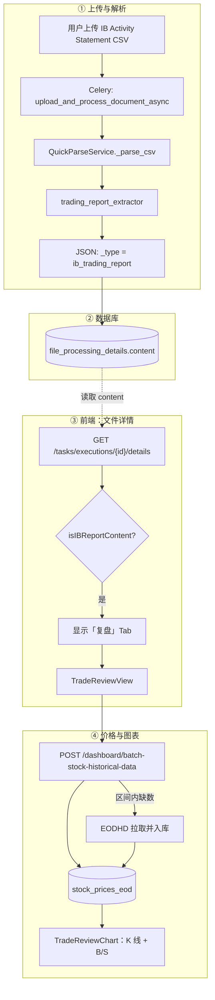

# 复盘（Trade Review）模块说明

本文档描述 Interactive Brokers「活动报告」上传后的解析流程、复盘 Tab 的数据链路、涉及的后端服务与数据库表，便于维护与扩展。

---

## 1. 功能概述

- **入口**：文件详情右侧面板，在系统识别为 IB 活动报告后，显示 **「复盘」** Tab。
- **内容**：按**股票**标的拆分，为每个标的展示 **K 线（lightweight-charts）**，并在图上标注成交日的 **B（买）/ S（卖）**。
- **范围**：仅展示**股票类**成交；期权、期货、外汇等非股票类在复盘侧排除（与 EODHD 可覆盖品种一致）。

### 流程总览（Mermaid）



以下为与上图对应的文字分步说明。

---

## 2. 端到端流程

### 2.1 上传与解析（活动报告 → 结构化内容）

| 步骤 | 说明 |
|------|------|
| 1 | 用户上传 CSV（IB Activity Statement 导出，英文或中文界面均可）。 |
| 2 | Celery 任务 `upload_and_process_document_async` 走 **Quick Process**（`QuickParseService`）。 |
| 3 | `_parse_csv` 调用 `backend.services.trading_report_extractor`：`is_ib_trading_report` → `extract_tables_from_content` → `to_structured_content`。 |
| 4 | 输出为 **单行 JSON 字符串**（`_type: ib_trading_report`），写入处理结果，供前端 Original / 各 Tab 使用。 |

识别条件（节选）：CSV 头部包含 `Interactive Brokers`、`BrokerName`，且标题为 `Activity Statement` 或 `活动账单` / `活动报告` 等。

### 2.2 前端识别与 Tab 展示

| 步骤 | 说明 |
|------|------|
| 1 | `FilesPage` 中 `OriginalContentView` 拉取 `GET /tasks/executions/{id}/details`，读取 `files[0].content`。 |
| 2 | `isIBReportContent(content)`：内容以 `{"_type"` 开头且解析后 `_type === 'ib_trading_report'` 则视为活动报告。 |
| 3 | 回调 `onIBReportDetected(parsed)` → `setIbReportDataForReview`，右侧面板显示 **复盘** Tab。 |
| 4 | 用户点击「复盘」→ 渲染 `TradeReviewView`，传入 `IBReportData`。 |

### 2.3 复盘数据与价格加载

| 步骤 | 说明 |
|------|------|
| 1 | `TradeReviewView` 从 `data.orders` 中按 `isStockAssetClass(asset_class)` 过滤，再按 `symbol` 分组为多个标的。 |
| 2 | 单笔调用 **`POST /api/dashboard/batch-stock-historical-data`**（`dashboardAPI.batchGetStockHistoricalData`），一次传入所有 `{ symbol, currency }`，默认 `days=365`，`fetch_missing=true`。 |
| 3 | 后端批量查库；缺失标的并行调用 EODHD 拉取并落库后，再读库返回 OHLCV。 |
| 4 | `TradeReviewChart` 绘制蜡烛图与 B/S 标记；**默认时间轴为约三个月**（以最后一笔成交附近为锚点，详见组件内注释）。 |

---

## 3. 涉及的主要服务与组件

### 3.1 前端

| 路径 / 模块 | 职责 |
|-------------|------|
| `web-frontend/src/pages/FilesPage.tsx` | `ibReportDataForReview`、`rightPanelView === 'review'`、复盘 Tab 与 `TradeReviewView` 挂载。 |
| `web-frontend/src/components/IBTradingReportView.tsx` | `IBReportData` 类型、`isIBReportContent`、活动报告 Tabs（Overview / M2M / Trades）。 |
| `web-frontend/src/components/TradeReviewView.tsx` | 股票过滤、按标的聚合、`batchGetStockHistoricalData`、汇总展示。 |
| `web-frontend/src/components/TradeReviewChart.tsx` | lightweight-charts K 线、B/S HTML 覆盖层与缩放/平移同步。 |
| `web-frontend/src/services/dashboard.ts` | `getStockHistoricalData`、`batchGetStockHistoricalData`。 |

### 3.2 后端（解析）

| 路径 | 职责 |
|------|------|
| `backend/core/quick_parse_service.py` | CSV Quick Process 入口，IB 报告走 `trading_report_extractor`。 |
| `backend/services/trading_report_extractor.py` | IB CSV 解析（中英章节名、交易列位置映射）、生成 `ib_trading_report` JSON。 |

### 3.3 后端（价格数据）

| 路径 | 职责 |
|------|------|
| `backend/api/dashboard.py` | `GET /stock-historical-data/{symbol}` 单标的；`POST /batch-stock-historical-data` 批量查库 + 缺失时并行 EODHD。 |
| `backend/services/eod_fetch_service.py` | 调用 EODHD API、`fetch_and_store_eod_data_with_timeout`、写入 `stock_prices_eod`。 |

### 3.4 外部服务

| 服务 | 用途 |
|------|------|
| **EODHD** | 当本地 `stock_prices_eod` 在请求区间内无足够数据时，按 `货币 + 代码` 推断交易所后缀（如 `.HK`、`.SHG`、`.US`）拉取日 K 并入库。 |

---

## 4. API 摘要

| 方法 | 路径 | 说明 |
|------|------|------|
| GET | `/api/tasks/executions/{execution_id}/details` | 任务详情，含 `files[].content`（IB 报告时为 JSON 字符串）。 |
| POST | `/api/dashboard/batch-stock-historical-data` | Body: `{ tickers: [{symbol, currency}], days?, fetch_missing? }`；返回各标的 OHLCV 列表。 |
| GET | `/api/dashboard/stock-historical-data/{symbol}` | 单标的历史（复盘优先使用批量接口，此接口仍被其他页面使用）。 |

复盘模块不直接调用 `POST /api/eod-fetch/fetch`；批量接口内部在缺数时通过 `EODFetchService` 完成拉取与存储。

---

## 5. 数据库与持久化

### 5.1 活动报告解析结果

| 表 | 字段 / 用途 |
|----|-------------|
| `file_processing_details` | `content` 存解析后的全文（IB 报告为 `ib_trading_report` 的 JSON 字符串，含 `tables`、`orders`、`markdown` 等）。 |
| `processing_stats` | 与任务执行关联的统计与元数据。 |

上传文件本体仍可能位于 OSS；详情页通过 `original_file_path` 等字段关联。

### 5.2 日 K 价格（复盘读取）

| 表 | 用途 |
|----|------|
| `stock_prices_eod` | 主数据源：`code`（含交易所后缀如 `1072.HK`、`600230.SHG`）、`date`、`open/high/low/close`、`volume`、`period='d'`。 |

批量接口对请求中的 `symbol` 与推断后缀（如 `symbol.HK`）做 **IN 查询**，命中则直接返回；未命中则对缺失标的并行调用 EODHD 写入后再查。

### 5.3 可选兜底

单标的 `GET /stock-historical-data` 在部分实现中还会尝试 `market_data_eod`（指数/商品等）；复盘批量路径以 `stock_prices_eod` 为主。

---

## 6. 数据契约（与前端对齐）

- **订单字段**（`orders[]`）：`asset_class`、`currency`、`symbol`、`trade_time`、`quantity`、`trade_price`、`close_price`、`proceeds`、`commission`、`basis`、`realized_pnl`、`mtm_pnl`、`trade_code` 等（与 `IBTradingReportView` 的 `ORDER_COLUMNS` 一致）。
- **股票判断**：`isStockAssetClass` 支持英文 `Stocks` / 中文 `股票` 等；非股票类不进入复盘标的列表。

---

## 7. 性能与行为说明

- **批量拉价**：一次 HTTP 请求完成所有标的的库查与缺数补拉，避免 N 次串行请求。
- **默认展示区间**：约 **90 天** 视窗（以最后一笔成交附近为参考），用户可缩放、平移查看更长区间。
- **首次上传**：若 `stock_prices_eod` 已有对应 `code` 的日 K，批量接口直接返回，**不会**为已有数据重复请求 EODHD；仅缺数标的触发外部拉取与入库。

---

## 8. 相关文件索引（便于检索）

```
web-frontend/src/pages/FilesPage.tsx
web-frontend/src/components/IBTradingReportView.tsx
web-frontend/src/components/TradeReviewView.tsx
web-frontend/src/components/TradeReviewChart.tsx
web-frontend/src/services/dashboard.ts
backend/core/quick_parse_service.py
backend/services/trading_report_extractor.py
backend/api/dashboard.py          # batch-stock-historical-data, stock-historical-data
backend/services/eod_fetch_service.py
```

---

*文档版本：与当前仓库实现一致；若接口或表结构变更，请同步更新本节。*
