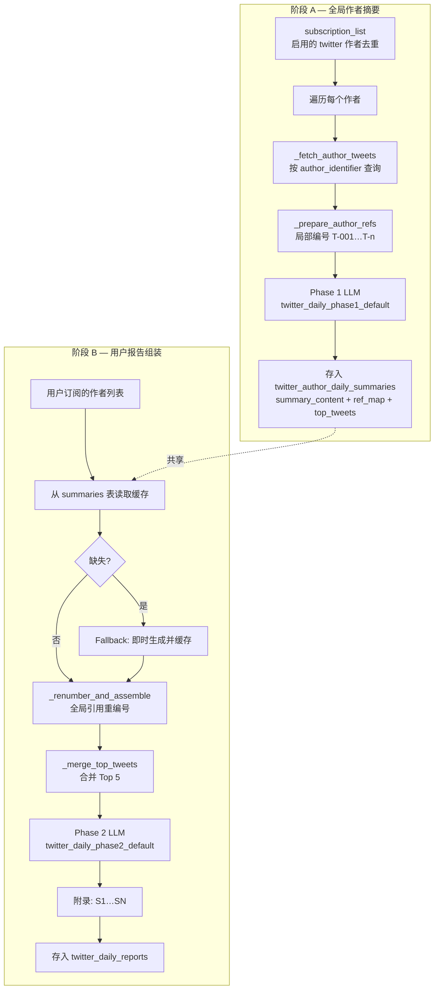
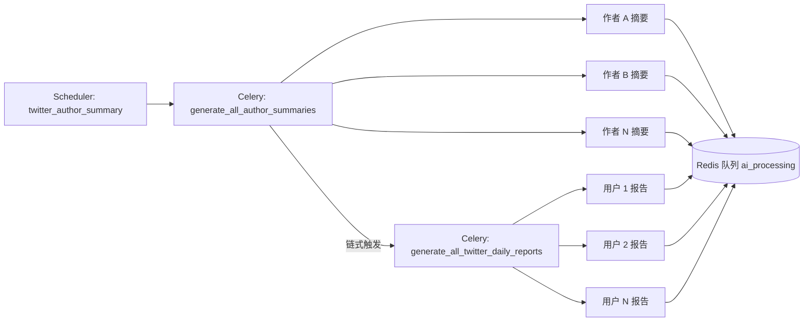

# Twitter Daily Report 功能手册

本文说明「Twitter 日报」在系统中的定位、数据流、两阶段解耦 LLM 策略、异步执行方式及运维要点。内容以当前仓库实现为准。

---

## 1. 功能概述

**Twitter Daily Report** 为每个用户按**自然日**汇总其「My Feeds」中可见的 **Twitter 订阅内容**，通过大语言模型生成一份 **Markdown 格式**的日报，并在正文中尽量保留对原推文的引用编号与链接，便于核对来源。

触发方式：

| 方式 | 行为 |
|------|------|
| **调度器**（`task_scheduling` 中类型为 `twitter_author_summary`） | Scheduler 先调用阶段 A（作者摘要），完成后自动链式触发阶段 B（用户报告） |

报告完全由 Scheduler 定时自动生成，前端页面仅提供只读浏览功能（按日期查看历史报告）。
单份报告在 LLM 侧可能耗时较长（常见数百秒），因此**实际生成始终在 Celery Worker** 中执行，避免阻塞 Web 进程与 Scheduler 事件循环。

---

## 2. 架构：两阶段解耦

### 2.1 核心思路

将原本 per-user 的 Phase 1（按作者摘要）提升为**全局共享**：

- **阶段 A（全局作者摘要）**：每个 Twitter 作者 × 每天只调用一次 Phase 1 LLM，结果存入 `twitter_author_daily_summaries` 表，所有订阅该作者的用户共享。
- **阶段 B（用户报告组装）**：读取预计算的作者摘要 → 全局引用重编号 → Phase 2 综合报告。

### 2.2 性能收益

假设 N 个用户平均订阅 M 个作者，作者重叠度为 R：

| 指标 | 优化前 | 优化后 |
|------|--------|--------|
| Phase 1 LLM 调用次数/天 | N × M | M/R（每作者一次） |
| 单用户报告生成耗时 | Phase1 + Phase2 ≈ 5-10分钟 | 仅 Phase2 ≈ 30-60秒 |

---

## 3. 与 My Feeds 的关系

- 用户通过「My Feeds」订阅 Twitter 源；抓取/同步后的条目落在 **`subscription_content`** 表中。
- 阶段 A 按 **`author_identifier`** 查询推文（不按用户过滤），生成全局摘要。
- 阶段 B 按用户的 **`subscription_list`** 确定该用户订阅了哪些作者，读取对应摘要。

因此：**没有当天 Twitter 数据则不会生成实质分析内容**。

---

## 4. 核心处理流程

### 4.1 阶段 A — 全局作者摘要（TwitterAuthorSummaryService）

| 步骤 | 代码位置 | 行为 |
|------|----------|------|
| 取作者 | `_get_distinct_enabled_authors` | 从 `subscription_list` 查询所有启用的 twitter 作者（去重） |
| 跳过判断 | `_get_existing_summary` | 若该作者+日期已有 `completed` 摘要且非 force，直接跳过 |
| 取推文 | `_fetch_author_tweets` | 按 `author_identifier` + 日期范围查询 `subscription_content`（不含用户过滤） |
| 编号 | `_prepare_author_refs` | 作者域局部编号 T-001…T-n |
| Phase 1 | `_run_phase1` | 超过 30 条时分 chunk，每 chunk 调用一次 LLM（模板 `twitter_daily_phase1_default`） |
| Top Tweets | `_get_author_top_tweets` | 提取该作者互动最高的 5 条推文（结构化数据） |
| 持久化 | `_update_summary` | 存入 `twitter_author_daily_summaries`：summary_content, ref_map, top_tweets |

### 4.2 阶段 B — 用户报告组装（TwitterDailyReportService）

| 步骤 | 代码位置 | 行为 |
|------|----------|------|
| 取订阅 | `_get_user_subscribed_authors` | 查用户的 `subscription_list` 中启用的 twitter 作者 |
| 读缓存 | `get_author_summaries_for_date` | 从 `twitter_author_daily_summaries` 批量读取 |
| Fallback | `generate_author_summary` | 对缺失的作者即时生成并写入缓存 |
| 重编号 | `_renumber_and_assemble` | 各作者局部 T-xxx → 全局连续 T-001…T-n |
| Top Tweets | `_merge_top_tweets` | 合并各作者 top tweets，全局排序取 Top 5 |
| Phase 2 | `_phase2_synthesize` | 一次 LLM 调用（模板 `twitter_daily_phase2_default`） |
| 附录 | `_append_author_summaries_appendix` | 追加 S1…SN 各作者摘要全文 |
| 落库 | `_update_report` | 写入 `twitter_daily_reports` |

### 4.3 引用编号机制

- 阶段 A：每个作者的推文在其摘要内使用局部编号 `T-001`…`T-n`
- 阶段 B 组装时：通过 `_renumber_and_assemble` 将各作者的局部编号重映射为全局连续序列
  - 例：作者 A 有 20 条 → T-001…T-020，作者 B 有 15 条 → T-021…T-035
  - 摘要文本中的 `[T-xxx]` 引用会被正则替换为新编号

---

## 5. 数据存储

### 5.1 `twitter_author_daily_summaries`（新增）

| 含义 | 说明 |
|------|------|
| 粒度 | 每个 `author_identifier` + `summary_date` **唯一**一行 |
| `summary_content` | Phase 1 LLM 输出的摘要文本 |
| `ref_map` | JSONB，该作者当日推文引用映射 `{T-001: {url, content, author, ...}}` |
| `top_tweets` | JSONB，该作者高互动推文列表 |
| `status` | `pending` / `generating` / `completed` / `failed` |

### 5.2 `twitter_daily_reports`

| 含义 | 说明 |
|------|------|
| 粒度 | 每个 `user_id` + `report_date` **唯一**一行 |
| `report_content` | Markdown 正文（含附录） |
| `status` | 如 `generating` / `completed` / `failed` 等 |
| `metadata` | JSON，含 `tweet_count`、`author_count`、`used_cached_summaries`、`fallback_generated` 等 |

### 5.3 `twitter_report_user_config`（库表）

迁移脚本中定义了**用户级配置表**（如 `phase1_template_code`、`phase2_template_code`、语言、生成时刻、主题与自定义指令等）。

---

## 6. 异步执行：Celery

### 6.1 任务

| 任务名 | 阶段 | 作用 |
|--------|------|------|
| `generate_author_summary` | A | 为单个作者生成指定日期的摘要 |
| `generate_all_author_summaries` | A | 批量分发所有作者的摘要任务，完成后可链式触发阶段 B |
| `generate_twitter_daily_report` | B | 为单个用户生成报告，读取预计算摘要 |
| `generate_all_twitter_daily_reports` | B | 批量分发所有用户的报告任务 |

队列：均为 **`ai_processing`**（见 `celery_config.py` 路由）。

### 6.2 链式调度

使用 `twitter_author_summary` 调度任务类型，`generate_all_author_summaries` 完成后会自动 `delay` 触发 `generate_all_twitter_daily_reports`，确保阶段 A 全部完成后再启动阶段 B。

---

## 7. 调度器（Scheduler）

### 7.1 配置

| 任务类型 | Cron | 说明 |
|----------|------|------|
| `twitter_author_summary` | `0 5 * * *` | 每天早上5点生成前一天所有作者摘要，自动链式触发 Daily Report |

> 注：`twitter_author_summary` 默认 `chain_daily_reports: true`，阶段 A 完成后自动触发阶段 B，无需单独配置 Daily Report 调度。

### 7.2 实现

- `_execute_twitter_author_summary_task`：调用 `generate_all_author_summaries_task.delay()`，完成后自动链式调用 `generate_all_twitter_daily_reports_task`

---

## 8. HTTP API（摘要）

前缀一般为 **`/reports/twitter-daily`**（以路由注册为准）：

| 方法 | 路径 | 说明 |
|------|------|------|
| GET | `""` | 分页列表 |
| GET | `/latest` | 最新已完成报告 |
| GET | `/{report_date}` | 按日期取详情 |

报告由 Scheduler 定时自动生成，API 层仅提供只读查询接口。

---

## 9. 前端行为（摘要）

- 页面以只读方式展示报告列表与正文（Markdown 渲染）。
- 左侧边栏按日期倒序列出历史报告，点击选中后在主区域展示 Markdown 内容。
- 支持通过 DatePicker 选择日期查看对应报告。
- 报告由 Scheduler 自动生成，前端不提供手动生成按钮。

---

## 10. 模板管理（Template Management）

- 系统默认 Phase1/Phase2 对应 **`llm_prompt_templates.template_code`**：`twitter_daily_phase1_default`、`twitter_daily_phase2_default`。
- Phase 1 模板由 `TwitterAuthorSummaryService` 使用，Phase 2 模板由 `TwitterDailyReportService` 使用。

---

## 11. 运维与排查

| 项目 | 说明 |
|------|------|
| Worker | 需消费 **`ai_processing`** 队列 |
| 日志 | Celery：`logs/celery_worker.log`；应用：`logs/app.log` |
| 作者摘要 | 查看 `twitter_author_daily_summaries` 的 `status` 和 `error_message` |
| 用户报告 | 查看 `twitter_daily_reports` 的 `status` 和 `error_message` |
| metadata | 报告 metadata 中新增 `used_cached_summaries`（缓存命中数）和 `fallback_generated`（即时生成数），可用于监控缓存效果 |

---

## 12. 流程图

### 12.1 总览：两阶段解耦架构

### 12.2 系统级调度

---

## 13. 版本与维护

- 常量与阈值：
  - `twitter_author_summary_service.py` 顶部：`DEFAULT_PHASE1_TEMPLATE`、`MAX_TWEETS_PER_AUTHOR_CHUNK`、`MAX_TOKENS_OUTPUT_PHASE1`
  - `twitter_daily_report_service.py` 顶部：`DEFAULT_PHASE2_TEMPLATE`、`MAX_TOKENS_OUTPUT_PHASE2`
- 数据库迁移：
  - `backend/database/migrations/create_twitter_daily_reports.sql`
  - `backend/database/migrations/create_twitter_author_daily_summaries.sql`（新增）

---

*文档生成自仓库实现，若代码与文档不一致，以代码为准。*
