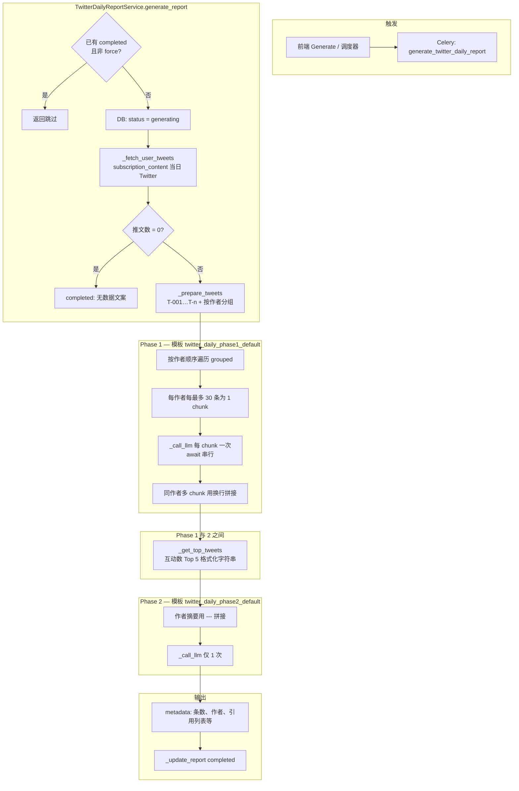
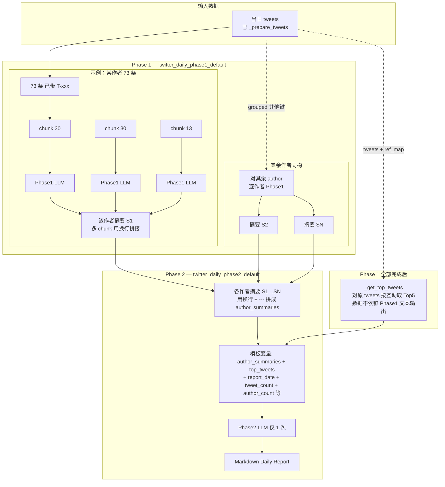
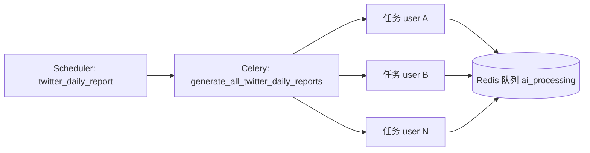

# Twitter Daily Report 功能手册

本文说明「Twitter 日报」在系统中的定位、数据流、两阶段 LLM 策略、异步执行方式及运维要点。内容以当前仓库实现为准。

---

## 1. 功能概述

**Twitter Daily Report** 为每个用户按**自然日**汇总其「My Feeds」中可见的 **Twitter 订阅内容**，通过大语言模型生成一份 **Markdown 格式**的日报，并在正文中尽量保留对原推文的引用编号与链接，便于核对来源。

典型触发方式：

| 方式 | 行为 |
|------|------|
| 用户在页面点击 **Generate Report** | 后端提交 **单用户** Celery 任务，前端轮询报告状态直至 `completed` / `failed` |
| **调度器**（`task_scheduling` 中类型为 `twitter_daily_report`） | Scheduler 调用 `generate_all_twitter_daily_reports`，为每个符合条件的用户各投递 **一条** Celery 子任务 |

单份报告在 LLM 侧可能耗时较长（常见数百秒），因此**实际生成始终在 Celery Worker** 中执行，避免阻塞 Web 进程与 Scheduler 事件循环。

---

## 2. 与 My Feeds 的关系

- 用户通过「My Feeds」订阅 Twitter 源；抓取/同步后的条目落在 **`subscription_content`** 表中。
- 报告生成时，服务按**用户 + 日期**查询该用户在当天能看到的 Twitter 行：
  - `channel_type = 'twitter'`
  - `published_at` 落在所选日期的 `[00:00, 次日 00:00)` 区间
  - 行记录需对当前用户可见（实现上使用 `user_ids` 数组包含该 `user_id` 等条件，与现有订阅模型一致）

因此：**没有当天 Twitter 数据则不会生成实质分析内容**（可能落库为「无数据」类说明，取决于实现分支）。

---

## 3. 核心处理流程（两阶段 LLM）

设计动机：单日、多作者、大量推文时，若一次性塞进单次 LLM 调用，易触发上下文上限且质量不稳定。故采用 **Phase 1 + Phase 2**。

### 3.1 预处理

1. **拉取推文**：见上一节 SQL 条件。
2. **全局引用编号**：为每条推文分配 `T-001`、`T-002`…，并写入 `ref_map`（含 URL、摘要片段、作者、时间、互动等）。
3. **按作者分组**：以 `author_identifier`（缺省则 `unknown`）分组，便于 Phase 1 分作者消化。
4. **单作者分块（chunk）**：若某作者推文超过 `MAX_TWEETS_PER_AUTHOR_CHUNK`（当前为 30），按块多次调用 Phase 1，再拼接该作者的摘要。

### 3.2 Phase 1 — 按作者摘要

- **模板代码（默认）**：`twitter_daily_phase1_default`（常量 `DEFAULT_PHASE1_TEMPLATE`）。
- **输入变量**（概念上）：作者展示名、日期、块内条数、格式化后的推文正文（含 `ref_id`、URL、转推/引用/回复等辅助行）、语言等。
- **输出**：每个作者（每作者可能多段）一段摘要文本，后续进入 Phase 2。

### 3.3 Phase 2 — 综合成篇

- **模板代码（默认）**：`twitter_daily_phase2_default`（常量 `DEFAULT_PHASE2_TEMPLATE`）。
- **输入**：所有作者摘要拼接、高互动推文摘要条（`top_tweets`）、日期、总条数、作者数等。
- **输出**：最终 **Markdown 报告正文**，写入 `twitter_daily_reports.report_content`。

### 3.4 LLM 调用链

- 服务通过 `llm_service.chat_completion_with_template(template_code=..., variables=...)` 调用。
- 模板正文来自数据库表 **`llm_prompt_templates`**，由 **`PromptRenderer`** 做变量校验与 `{{变量名}}` 替换。
- **注意**：`llm_prompt_templates.variables` 字段须为 **JSON 对象**，且每个变量定义为带 `type` / `required` / `description`（及可选 `default`）的结构；若写成「键 → 纯字符串说明」会导致渲染阶段报错。

### 3.5 与实现一致的细化流程（对应 `generate_report`）

下列步骤与 `backend/services/twitter_daily_report_service.py` 中 `generate_report` → `_phase1_author_summaries` → `_phase2_synthesize` 的调用顺序一致。

| 阶段 | 代码位置 | 行为 |
|------|----------|------|
| 入口 | `generate_report` | 若 `force=False` 且该日已有 `status=completed` 的报告，**直接返回**（不跑 LLM）。 |
| 状态 | `_upsert_report_status` | 插入或更新行，将状态置为 **`generating`**。 |
| 取数 | `_fetch_user_tweets` | `subscription_content`：`channel_type='twitter'`，`published_at` 在报告日当天，`user_id = ANY(user_ids)`，按 **`published_at ASC`**。 |
| 无数据 | — | 更新为 `completed`，正文为「当天无推文数据。」，`metadata.tweet_count=0`，结束。 |
| 预处理 | `_prepare_tweets` | 按推文顺序分配全局编号 **`T-001`…`T-n`**；构建 **`ref_map`**；按 **`author_identifier`**（缺省 `unknown`）分组为 **`grouped`**。 |
| Phase 1 | `_phase1_author_summaries` | 见下表。 |
| 高互动摘录 | `_get_top_tweets` | 按 **`engagement_count` 降序**取前 **`top_n=5`** 条，格式化为单行文本（含 `ref_id`、作者、预览、URL），**仅进入 Phase 2**，不单独调用 LLM。 |
| Phase 2 | `_phase2_synthesize` | **一次** `chat_completion_with_template`，模板 `twitter_daily_phase2_default`。 |
| 落库 | `_update_report` | `status=completed`，写入 `report_content` 与 **`metadata`**（见 4.1）。 |

**Phase 1 内部（逐作者、串行 await）**

- 遍历 **`grouped.items()`**（Python 3.7+ 字典按插入顺序；作者顺序与首条推文出现顺序一致）。
- 每位作者若推文数 **> 30**，按 **`MAX_TWEETS_PER_AUTHOR_CHUNK=30`** 切成多个 **chunk**。
- **每个 chunk** 调用一次 **`_call_llm`**，模板 **`twitter_daily_phase1_default`**，`max_tokens=MAX_TOKENS_OUTPUT_PHASE1`（2000）。
- 输入正文由 **`_format_author_tweets`** 生成：含 `ref_id`、时间、互动、正文、URL，以及转推/引用/回复等附加行。
- 同一作者多个 chunk 的返回用 **`\n\n` 拼接**为该作者的一条摘要。

**Phase 2 输入拼接**

- 各作者摘要按 **`author_summaries` 字典的 values 顺序**用 **`\n\n---\n\n`** 拼成 `author_summaries` 变量（代码为 `join` 各 `summary`，作者名不重复写入拼接串，顺序与 `grouped` 迭代顺序一致）。
- 另传入：`report_date`、`author_count`、`tweet_count`、`top_tweets`、`report_language`（当前固定 `'zh'`）、`focus_topics_instruction` / `custom_instructions`（当前固定空串）。

**并发说明（与图中「多路并行」的差异）**

- **单用户、单份报告**内：Phase 1 各 chunk、Phase 2 **均为 `await` 串行**，**不会**并行调用多个 Phase 1 LLM。
- **多用户**：由 Celery 为每用户独立任务；是否并行取决于 Worker 进程数 / `solo` vs `prefork`（见第 5 节）。

---

## 4. 数据存储

### 4.1 `twitter_daily_reports`

| 含义 | 说明 |
|------|------|
| 粒度 | 每个 `user_id` + `report_date` **唯一**一行 |
| `report_content` | Markdown 正文 |
| `status` | 如 `generating` / `completed` / `failed` 等 |
| `metadata` | JSON，常含 `tweet_count`、`author_count`、`generation_time_seconds`、`tweet_references` 等 |
| `error_message` | 失败时错误信息 |

### 4.2 `twitter_report_user_config`（库表）

迁移脚本中定义了**用户级配置表**（如 `phase1_template_code`、`phase2_template_code`、语言、生成时刻、主题与自定义指令等）。**是否被当前 `TwitterDailyReportService` 读取以仓库中服务代码为准**；若需「每用户不同模板」，应保证服务层读取该表并把 `template_code` 传入 `_call_llm`，或与 Template Management 中的用户偏好表联动。

---

## 5. 异步执行：Celery

### 5.1 任务

| 任务名 | 作用 |
|--------|------|
| `generate_twitter_daily_report` | 参数：`user_id`、`report_date`（字符串）、`force`。内部 `asyncio` 跑 `TwitterDailyReportService.generate_report`。 |
| `generate_all_twitter_daily_reports` | 参数：`report_date`。查询「需生成」的用户列表，为**每个用户** `delay` 一条 `generate_twitter_daily_report`。 |

队列：通常为 **`ai_processing`**（见 `celery_config.py` 路由）。

### 5.2 多用户是并行还是排队？

- **分发阶段**：`generate_all` 会向队列投递 **N 个独立任务**，彼此解耦。
- **执行阶段**：由 Worker **并发度**决定。例如开发环境 macOS 脚本可能使用 `solo` 池，则**同一 Worker 进程内串行**执行多个任务；Linux 生产常用 `prefork` + `concurrency>1`，则**最多同时处理多份**报告（具体以启动参数为准）。

---

## 6. 调度器（Scheduler）

- 在 **`task_scheduling`** 中配置 `task_type = 'twitter_daily_report'` 及 Cron 表达式。
- Scheduler 服务内注册 `_execute_twitter_daily_report_task`：不直接跑 LLM，而是 **`generate_all_twitter_daily_reports_task.delay(report_date=...)`**，立即返回 Celery 任务 ID，避免长时间占用调度线程。

---

## 7. HTTP API（摘要）

前缀一般为 **`/reports/twitter-daily`**（以路由注册为准）：

| 方法 | 路径 | 说明 |
|------|------|------|
| GET | `""` | 分页列表 |
| GET | `/latest` | 最新已完成报告 |
| POST | `/generate` | 提交 Celery 任务；若未 `force` 且该日已有 `completed`，可返回跳过 |
| GET | `/{report_date}` | 按日期取详情（含 `status`，供前端轮询） |

手动生成返回体中通常包含 **`task_id`**，前端通过定时请求 **`GET /{date}`** 判断 `generating` → `completed`/`failed`。

---

## 8. 前端行为（摘要）

- 页面展示某日报告列表与正文（Markdown 渲染）。
- 点击生成后：先 POST `/generate`，再**轮询** GET 指定日期，直到状态不再是 `generating`（实现细节以 `TwitterDailyReportPage.tsx` 为准）。
- 使用 Ant Design `App` 包裹以正确使用 `App.useApp()` 的消息 API。

---

## 9. 模板管理（Template Management）

- 系统默认 Phase1/Phase2 对应 **`llm_prompt_templates.template_code`**：`twitter_daily_phase1_default`、`twitter_daily_phase2_default`。
- 在 **Template Management** 中维护分类（如「报告生成」）、系统/用户 scope 等，与全局模板体系一致。
- 若新增「用户专属模板」，需在库中有唯一 `template_code`，且 **variables 定义格式**符合 `PromptRenderer` 要求；并让生成服务在调用 LLM 时传入对应 `template_code`（当前默认实现固定为上述两个常量）。

---

## 10. 运维与排查

| 项目 | 说明 |
|------|------|
| Worker | 需消费 **`ai_processing`** 队列，否则任务堆积 |
| 日志 | Celery：`logs/celery_worker.log`；应用：`logs/app.log`（视日志配置而定） |
| 失败 | 查看 `twitter_daily_reports.status=failed` 与 `error_message`；同时查 Worker 栈与 LLM 返回 |
| 性能 | 单用户报告耗时长时，横向扩展方式为多 Worker 或提高并发（注意 LLM 配额与数据库连接） |

---

## 11. 流程图（与实现对齐）

下列图示对应你提供的「Phase1 多作者 → Phase2 综合分析 → Markdown」结构，并补充**代码中的前置步骤、chunk、top_tweets 与串行语义**。

### 11.1 总览：从数据到 Markdown（单用户单次生成）

### 11.2 与你示意图的对应关系

| 示意图元素 | 代码中的对应物 |
|------------|----------------|
| @作者 + N tweets | `grouped[author_identifier]` 下列表；展示名用 `author_name` 传入 Phase1 变量 |
| 摘要 1 … 摘要 N | `author_summaries` 字典；每位作者一条（可能由多 chunk 拼成） |
| LLM 综合分析 | `_phase2_synthesize` 单次调用，`DEFAULT_PHASE2_TEMPLATE` |
| Markdown Daily Report | `report_content` 写入 `twitter_daily_reports` |

**图中未画出但代码存在的一步**：在综合分析前增加 **`top_tweets`（高互动 Top 5）** 作为 Phase2 的额外输入，与「各作者摘要」一起进入第二次 LLM。

### 11.3 Phase 1 + Phase 2 放大（含 chunk 与单次综合分析）

下图与代码顺序一致：先完成**所有作者**的 Phase 1；再在同一批 `tweets` / `ref_map` 上计算 **`_get_top_tweets`**（执行顺序在 Phase 1 之后，数据不依赖 Phase 1 输出）；最后 **Phase 2 仅 1 次** LLM 产出 Markdown。

**读图要点**

- **Phase 1**：每位作者独立；单作者超过 30 条则多块、多块多次 Phase1 LLM，再拼成一条摘要。多作者则有多条 `S1…SN`（图中细画第一位作者，`OTH` 表示其余 `author_identifier` 上同一套逻辑）。
- **`_get_top_tweets`**：在 Phase 1 **全部跑完以后**才调用，但输入仍是**原始** `tweets` + `ref_map`，不读各作者摘要文本。
- **Phase 2**：**只有一次** `twitter_daily_phase2_default` 调用；`VARS` 同时包含拼接后的 **`author_summaries`**、**`top_tweets`**，以及 `report_date` / `tweet_count` / `author_count` 等（见 `_phase2_synthesize`）。

### 11.4 系统级：多用户调度（与单用户流程正交）

每个 `generate_twitter_daily_report` 任务内部仍执行 **11.1** 的整条流水线；Worker 是否同时跑多个用户任务取决于进程池与并发配置。

---

## 12. 版本与维护

- 常量与阈值：`twitter_daily_report_service.py` 顶部 `DEFAULT_PHASE*`、`MAX_TWEETS_PER_AUTHOR_CHUNK`、`MAX_TOKENS_OUTPUT_*`。
- 数据库迁移：`backend/database/migrations/create_twitter_daily_reports.sql`。
- 修改默认提示词：优先改 **`llm_prompt_templates`** 中对应记录，并保持 **variables JSON 结构合法**。

---

*文档生成自仓库实现，若代码与文档不一致，以代码为准。*
